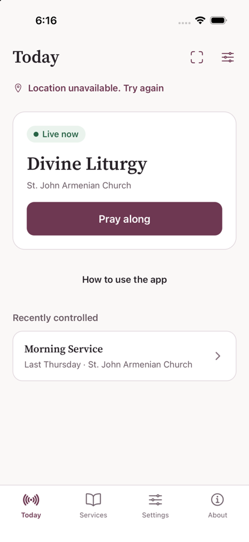
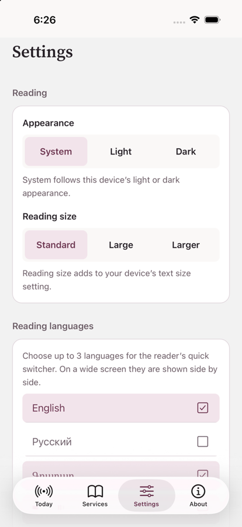
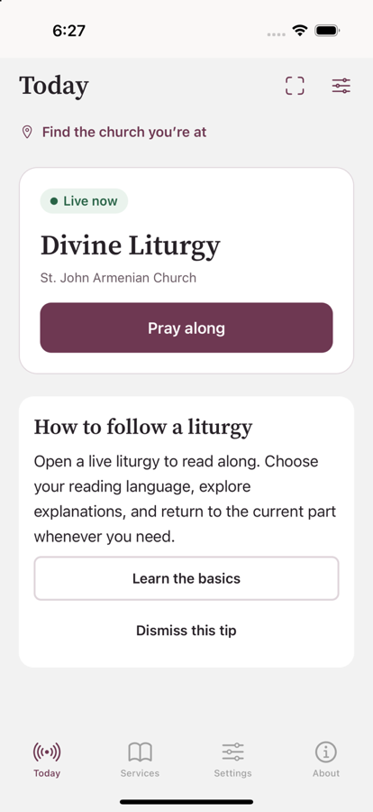

# Liquid Glass for the iOS app: investigation (#234)

Investigation only. No app code changes. Written 2026-09-29 against Expo SDK 57 (`expo` 57.0.26,
`expo-router` 57.0.24, React Native 0.86.3, `react-native-screens` 4.26.2), main at `e656b28`.

## Recommendation

1. **Do not restyle the JavaScript chrome to imitate glass.** The app draws its own tab bar, headers,
   sheets, buttons and controls in JavaScript, so it currently gets **none** of the system's Liquid
   Glass, even on iOS 26. Faking it would be work that native components do better and that still would
   not adapt to Reduce Transparency, Dynamic Type or the next OS release.
2. **Adopt glass by moving specific chrome to native components, iOS only.** In order of value for
   effort: the tab bar (proven in a spike below), then the two service sheets and `AppModal`.
   Everything else stays as it is. Reading and projection surfaces stay flat.
3. **First, and independent of the design work, fix the build-toolchain risk below.** An app built with
   the iOS 27 SDK crashes at launch today. Nothing in this investigation can ship if a routine EAS image
   update pulls that SDK in.

Rough sizing is in [Plan](#plan). Follow-up issues are proposed there and **not filed**.

## What was checked

| Question | How | Result |
| --- | --- | --- |
| What do we ship today? | `eas build:list` and the Xcode log of the last iOS production build (`c1b0431b`, 0.2.0, 2026-09-28) | Compiled against `iPhoneOS26.5.sdk`. `app.json` sets no design opt-out key. Deployment target is iOS 16.4 |
| What does the current app look like on iOS 26? | Release build for the simulator; iOS 26.5 runtime | Flat and opaque everywhere (screenshot below) |
| Does it run on the iOS 27 SDK? | Same build on an iOS 27.0 simulator | **Crashes at launch** (see [Toolchain risk](#toolchain-risk-ios-27-sdk)) |
| Would native tabs give glass? | Throwaway spike (not in this PR), iOS 26.5 and 18.6 runtimes | Yes on 26; classic native bar on 18 |
| Web and Android | Read the `expo-router` sources for both | Native tabs would change both; keep the JS bar there |

Builds used `LANG=en_US.UTF-8`, the production `EXPO_PUBLIC_*` endpoints,
`SENTRY_DISABLE_AUTO_UPLOAD=true`, Release configuration, on the iOS simulators installed on this Mac
(18.2, 18.6, 26.2, 26.5, 27.0).

## Findings

### 1. Today the app gets no glass, even on iOS 26

`app/(tabs)/_layout.tsx` uses Expo Router's JS `Tabs` with a custom `tabBar` (`components/TabBar.tsx`),
`headerShown: false` everywhere, and screens draw their own headers (`ScreenHeader`). `AppButton`,
`SegmentedControl`, `Surface`/`Card` and the checkboxes on Settings are all JS views with opaque
backgrounds. The system restyles only native UIKit views, so a rebuild against a newer SDK changes
nothing visible.

The two places that already use native presentation are the reader's sheets
(`app/(signed-in)/services/[id]/_layout.tsx`, `presentation: 'formSheet'`) and `AppModal`
(`Modal` with `pageSheet`). Both paint an **opaque** background over the system's
(`contentStyle: { backgroundColor: colors.overlay }` and an opaque shell view) and the sheets force a
custom corner radius (`sheetCornerRadius: radii.sheet`). That is what blocks the system material there.
See [What was not verified](#what-was-not-verified).

### Toolchain risk: iOS 27 SDK

The baseline build, linked against the iOS 27 SDK, **crashes at launch on an iOS 27 runtime** with
`EXC_BREAKPOINT` in `___UIApplicationEvaluateRuntimeIssueForNoSceneLifecycleAdoption`: apps built with
the iOS 27 SDK must adopt the UIScene lifecycle. The generated project uses a classic `AppDelegate` with
no `UIApplicationSceneManifest`. Expo knows about this: `ExpoAppSceneDelegate.swift` in SDK 57 says it is
"required by the iOS 27, which asserts at launch unless the app adopts the scene-based life cycle". But
SDK 57's project template does not use it. `expo-template-bare-minimum@sdk-58` (58.0.8) does
(`SceneDelegate.swift` plus the scene manifest). SDK 58 was published on 2026-09-29 (`next`; `latest` is
still 57).

Builds from the same toolchain run normally on iOS 26.5 (baseline and spike) and iOS 18.6 (spike), and production builds use the 26.5 SDK, so
**nothing is broken today**. The risk is that `eas.json` pins no build image, so which Xcode EAS uses is
not under our control. If it moves to an Xcode with the iOS 27 SDK before we have scene support, the next
release would crash on launch on iOS 27 devices. Pin the image, and plan the SDK 58 upgrade (or manual
scene adoption) as its own piece of work. Apple's dates for when the iOS 27 SDK becomes mandatory for
App Store submissions are not stated here and should be checked.

### 2. Native tabs give real glass, with integration work

A throwaway spike replaced the tab bar on iOS with `NativeTabs` from `expo-router/unstable-native-tabs`
(SF Symbols for icons, `tintColor` set to the brand color, `minimizeBehavior="onScrollDown"`), leaving
web and Android on the existing JS bar. The spike was reverted and is not in this PR.

Observed:

- **iOS 26.5:** a floating, translucent capsule with a highlighted selected item, and content visible
  beneath it. This is the system's own Liquid Glass. Nothing was drawn by us.
- **iOS 18.6:** the same build shows the standard flat native tab bar. Degradation is automatic.
- **Page background changed.** The native tab host ignores `sceneStyle`: the page is system gray
  instead of the app's warm off-white, and the strip behind the status bar no longer matches. This needs
  explicit background handling.
- **Content under the bar.** The floating bar overlays scrolling content, so screens need bottom
  content insets. Not verified (see below).
- `NativeTabs` lives under `unstable-native-tabs`, so its API can change between SDKs.

### 3. Web and Android must keep the JS bar

`NativeTabsView.web.js` renders a Radix Tabs component with the router's own CSS, and
`NativeTabsView.android.js` renders a Material bar from `react-native-screens`. Both would change what
web.tarkman.app and Android look like. Native tabs must therefore be iOS only (a Platform branch or an
`_layout.ios.tsx`), keeping `components/TabBar.tsx` for the rest. That keeps `tests/home-ui.test.tsx`
(which renders `TabBar` directly) valid. One Maestro flow, `maestro/fixture-sign-in.yaml`, taps the
`tab-about` test ID, which a native bar does not have; it would need to target the tab by its label.
Onboarding coachmarks spotlight reader controls, not tab items, so they are unaffected.

### 4. Options compared

| Option | Verdict |
| --- | --- |
| Do nothing | Safe, but the app looks flat next to iOS 26 apps and stays flat as the OS moves on |
| `GlassView` (`expo-glass-effect`) on the JS tab bar | Not worth it. The bar sits below the content rather than over it, so glass has nothing to refract; making it float means giving every screen bottom insets, which native tabs do for free |
| **Native tab bar, iOS only** | Recommended first step. Real glass, Dynamic Type, minimize on scroll, automatic fallback on older iOS |
| **Native sheets** (`formSheet` with a transparent background and the system corner radius; `AppModal`) | Recommended second step; needs a visual check first |
| `GlassView` on a few floating controls | Optional and low priority. Useful only where a control floats over content |
| `@expo/ui` SwiftUI `glassEffect` | Not recommended. Adds SwiftUI hosting for what native components already provide |

### 5. What should be glass, and what must stay flat

| Surface | Decision |
| --- | --- |
| Tab bar | Native glass (iOS only) |
| Reader service sheets, `AppModal` | System sheet material, after removing the opaque overrides |
| Primary buttons (`Pray along`) | Stay solid brand color; a glass button would lose the brand and contrast |
| Cards and lists | Stay flat; glass is for controls floating over content, not for content |
| Reading text, projection and preview surfaces (`LiturgyText`, `DisplayProjection`, `PreviewStage`) | **Stay flat**, the same rule as the Apple TV display |
| Status pills, badges | Stay flat |

### 6. Accessibility

- System glass adapts by itself to Reduce Transparency and Increase Contrast. Any custom translucent
  fallback we write must go opaque: use `AccessibilityInfo.isReduceTransparencyEnabled()` and the
  `reduceTransparencyChanged` event (both exist in React Native 0.86, iOS only). The tvOS `Glass`
  fallback in `apps/tv` has the same gap, so a small shared helper for the check is a non-blocking
  follow-up.
- A native tab bar handles Dynamic Type itself. The JS bar caps label growth at 1.6x by hand.
- Dark mode: the native bar follows the system appearance. The app's own `appearance` preference
  (System, Light, Dark) needs to be forwarded so the bar matches an in-app override. Not verified.

### 7. Dependencies

`expo-glass-effect` (57.0.4) and `@expo/ui` (57.0.21) are **transitive** dependencies of `expo-router`,
not direct ones. Using either directly means adding it with `npx expo install`. `expo-glass-effect`
renders a plain `View` on Android, web and iOS before 26, so it is safe cross-platform. The app's iOS
deployment target is 16.4, which stays, since glass is opt-in per component behind an availability check.

### 8. Sharing with the Apple TV app

Only design tokens are shared, through `@tarkman/design`. There is no shared React component package
(`tarkman-reader` must not import React), and creating one just for glass is not worth it: the TV `Glass`
uses the same `expo-glass-effect` module but different shapes and focus behavior.

## Plan

Rough sizes assume one developer and include testing.

| # | Work | Size | Notes |
| --- | --- | --- | --- |
| 0a | Pin the EAS iOS build image; add a CI or release check on the SDK used | S | Independent of glass; removes the toolchain risk |
| 0b | Plan the SDK 58 upgrade (or manual scene adoption) | M–L | Its own issue; unblocks building with the iOS 27 SDK |
| 1 | iOS-only native tab bar: background, bottom insets, icons, appearance preference, Maestro flow | M | Behind a Platform branch; web and Android untouched |
| 2 | Native sheets: transparent background, system corner radius, `AppModal` on native presentation | M | Needs a visual pass on device or simulator first |
| 3 | Optional: `GlassView` on floating controls; shared Reduce Transparency helper (mobile and TV) | S | Low priority |

Not doing: imitating glass in JavaScript, changing reading or projection surfaces, and a shared component
package.

### Proposed follow-up issues (not filed)

1. Pin the EAS iOS build image and guard against the iOS 27 SDK until scene support lands.
2. Upgrade to Expo SDK 58 (or adopt the scene lifecycle on SDK 57).
3. iOS native tab bar with glass (Plan step 1).
4. Native sheets for the reader and `AppModal` (Plan step 2).
5. Shared Reduce Transparency check for mobile and TV.

## What was not verified

- **Sheets and native controls.** I could not drive the simulator on the iOS 26.5 device (access was not
  granted), so I did not open the reader's `formSheet`s, `AppModal`, an alert or a `Switch` (used in the
  display-link editor) and did not see what glass they get. The claim that the opaque overrides block the
  system material is from the code, not from a screenshot.
- **Scroll behavior of native tabs:** minimize on scroll, and whether every screen's content can scroll
  clear of the floating bar.
- **`UIDesignRequiresCompatibility`**, the Info.plist key that opts an app out of the new design, was not
  tested against the 26.5 or 27 SDK. We do not set it and are not recommending it.
- **A physical iPhone.** Everything above is from simulators (iOS 18.6, 26.5, 27.0).
- **The iOS 27 launch crash was seen on a simulator** with a build produced by Xcode 27; it was not
  reproduced on a device.
