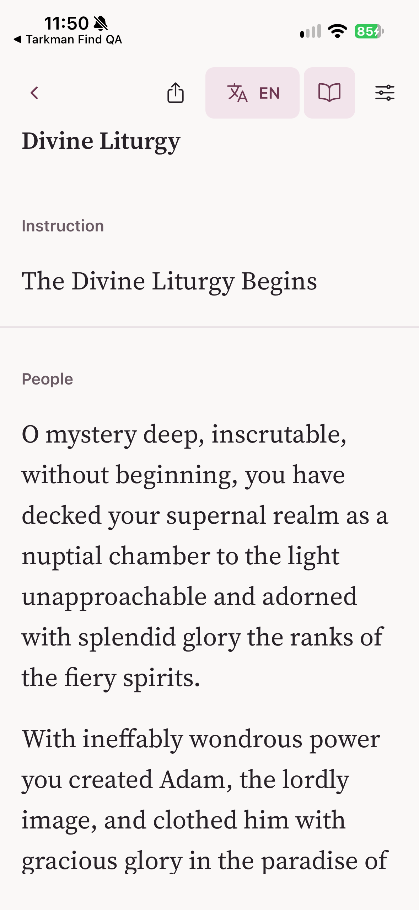

# Opening-only Siri / Shortcuts feasibility (#275)

## Current checkpoint

The initial report below records the first evidence checkpoint. Following the
owner's continuation request, this draft also contains a native prototype,
**prepared in a separate copy outside the normal mobile dependency graph**.
The production app/data must never be replaced for this test.

An earlier config-gated attempt was insufficient: even with the flag unset,
Expo autolinking resolved the experimental `expo-app-intents` dependency and
its nested `@expo/ui`. The config equality tests proved only config equality,
not native-graph isolation. Automated orchestration review on the owner's behalf
caught this boundary error; this was not human code-review approval. The normal
mobile manifest, lockfile and layout are therefore restored to main; prototype
sources and dependency installation now belong only to the separate prepared
copy. Do not use the superseded `TARKMAN_SIRI_SPIKE` workflow in the normal app.
After restoring and running a fresh normal `npm ci`, actual unflagged Expo
Apple autolinking resolves **33 modules, with neither `expo-app-intents` nor
`@expo/ui` present**. The normal manifest, lockfile and layout match the pinned
main bytes; the separate preparation/path/source-preservation tests pass.

Only the prepared prototype imports/mounts the root handler; the normal app
and prepared baseline do not. It waits for router and Library readiness,
validates canonical IDs, navigates
only to the existing reader, serializes pending invocations, and acknowledges
after route application. Acknowledgment failure can retry without repeating
navigation within that consumer's lifetime. Cross-process exactly-once delivery
is not promised; reader navigation uses replacement rather than stacking copies.
No new content cache, indexing, entity catalog or service command is added.

Baseline checks passed: **98 suites / 1,305 tests**, typecheck, lint and web export.
The earlier prototype head `ef31dede` passed CI: **100 suites / 1,327 tests**,
typecheck, lint and web export. A local full-suite attempt under severe compiler
contention was interrupted after UI test timeouts; CI ran the complete suite
successfully. The compiler-only probe below passed as documented. Both the
initial report-only tree and `ef31dede` received complete scoped-clean independent
GPT-6.1 Sol reviews. Those reviews did not establish native/device readiness or
catch the native-graph boundary error. The revised external prototype also passed
its full **100 suites / 1,327 tests**, typecheck, lint, prebuild, CocoaPods install
and an iOS JS export. Tests were run with build-only Library flags unset; those
flags otherwise intentionally conflict with configuration-contract assertions.
The final revised head still needs its independent review.

Physical discovery initially found `passcodeRequired=true`; the owner then
confirmed unlocking, and a subsequent device query confirmed
`passcodeRequired=false`. A public catalog request returned HTTP 200 with
production liturgy ID **1 (Divine Liturgy)**, suitable for the next device test
rather than synthetic fixture 701. The earlier iOS prebuild and CocoaPods install
passed. A signed build with team `FHF872BAQR` and the isolated bundle identifier
was actively compiling, but was intentionally stopped before installation when
orchestration review established the default native-graph change. No native-build pass
or failure is inferred from that interruption. The generated project was retired
outside the normal app, and no production profile was reused.
The corrected external **baseline** has since completed a real signed Release
build and physical install. Signature verification passed; the development
profile names `FHF872BAQR.app.tarkman.sirispike`, deployment minimum is **16.4**,
and the signed app claims no production URL scheme, associated domains or App
Groups. Opening public liturgy 1 through its isolated URL rendered the existing
reader on the physical iPhone. This is **not** a Siri/Shortcuts demonstration.

### Before — actual pinned main baseline

Source `d459fa5e9e2685b7cbc9f8e79605e0bc2f4b2b1d`, isolation-only config, no new
intent dependency/Swift/handler. iPhone 15 Pro, iOS 27.2, 1179×2556 pixels,
light theme, English, public Divine Liturgy (ID 1), top of the online reader.
No worker preference changes or data reset. See the
[capture record](../../../spikes/siri-shortcuts/evidence/before.json).



### After — still outstanding

The separate prototype signed native build is running. Its signed install,
actual Shortcuts/Siri cold/warm/error runs and a matching changed-revision
capture remain outstanding; **this draft is not ready**. The phone was released
for the parallel Library QA work after baseline capture; the next install/capture
requires a coordinated slot.

Use the [external preparation workflow](../../../spikes/siri-shortcuts/README.md),
not a normal-app native build command. It exports the pinned main revision,
prepares a genuine baseline without the action and a prototype with the action,
and installs experimental dependencies only in the prototype copy. Both copies
unconditionally use the same isolated identity, including when no flag is set.
Verify the generated app's bundle ID is `app.tarkman.sirispike` before installing.
The isolated scheme is `tarkman-siri-spike:///liturgies/1`; the prototype has no
production universal-link association. Running that URL is a navigation check,
not a substitute for invoking the actual Open Liturgy action from Shortcuts/Siri.
Do not publish this binary through a production EAS project/channel.

## Initial decision and scope (report-only checkpoint)

**Go for a bounded native prototype; no-go for production rollout on this evidence.**
This is the go/no-go-report alternative requested in
[issue #275](https://github.com/mattash/Tarkman-Client/issues/275#issuecomment-6881479291),
not an installed Siri feature or a completed physical-iPhone demonstration.
Assessed on 2026-11-14 against main
`d459fa5e9e2685b7cbc9f8e79605e0bc2f4b2b1d` (merged SDK prerequisite
[PR #273](https://github.com/mattash/Tarkman-Client/pull/273)).
No app dependency, native target, navigation, entitlement, UI, deployment target,
TV app, shared reader, or release configuration changes are included.

The feasibility boundary is opening one explicitly chosen public liturgy in the
existing reader. No service commands, authentication/display tokens, background
JS, reading-history exposure, or Android assistant implementation.

## Evidence and compatibility

- Installed Expo `58.0.25` recommends `expo-app-intents ~0.5.17` in
  `node_modules/expo/bundledNativeModules.json`. `npm pack expo-app-intents@0.5.17`
  succeeded; this is an obtainable package, not just a changelog promise.
  Registry integrity: `sha512-OPa4LXdzDfO7TGhnLaUW9+6H0s6lJsvIMawTwFKwZFKCpkrz74JFxdMSmb8GQz09bErcyhdZwDSErmX6hHup1Q==`.
- [SDK 58 documentation](https://github.com/expo/expo/blob/sdk-58/docs/pages/versions/v58.0.0/sdk/app-intents.mdx)
  explicitly calls it **alpha**, subject to frequent breaking changes.
  [Package sources](https://github.com/expo/expo/tree/sdk-58/packages/expo-app-intents)
  and the published 0.5.17 tarball were inspected, including README, podspec,
  plugin, dispatcher, queue, and initializer templates.
- The podspec declares iOS **16.4**, Swift **6.0**, ExpoModulesCore and ExpoUI.
  This does not require raising Tarkman's existing 16.4 app deployment target.
  Newer APIs must be availability-gated independently.
- Swift intent types and `AppShortcutsProvider` must compile into the **app
  target**, not only a static pod. Initialization configures the plugin and
  `experiments.inlineModules.watchedDirectories: ["app-intents"]`; a new native
  build/prebuild is required. An OTA update or Expo Go is not sufficient.
- The inspected plugin validates the watched directory; it does not add a Siri
  extension, App Group, signing entitlement, or deployment-target override.
  App-target metadata extraction and installation still require a real Xcode
  build. Package inspection is not proof that an archive will extract metadata.
- Dispatch records a native pending invocation before sending a JS event.
  Delivery is **at least once**, not exactly once. `useAppIntents` drains cold
  invocations and observes warm ones; remove each invocation by its unique ID
  only after the intended foreground navigation/error handling is applied.
  `perform()` dispatch completion does not establish successful reader opening.
- `openAppWhenRun = true` is the intended foreground model. Do not promise JS
  execution while the app stays closed, lock-screen bypass, or offline freshness.
- Xcode **27.2 (27B52)**, iPhoneOS SDK **27.2**, Swift **6.4.2** were available.
  A direct Apple `OpenURLIntent` candidate failed typechecking when declared
  available at 16.4: the compiler requires **iOS 18.0**. Gating both that intent
  and its shortcut provider at 18.0 permits compilation with a 16.4 deployment
  target; older systems must keep ordinary Library links/reader behavior.
  This Apple-only proof does **not** validate Expo's dispatcher or JS integration.

## Reproducible compiler-only probe

Save the following as `OpenLiturgyIntent.swift` **outside the app target** and run:

```sh
xcrun swiftc -typecheck -sdk "$(xcrun --sdk iphoneos --show-sdk-path)" \
  -target arm64-apple-ios16.4 OpenLiturgyIntent.swift
```

```swift
import AppIntents
import Foundation

@available(iOS 18.0, *)
struct OpenLiturgyIntent: AppIntent {
  static let title: LocalizedStringResource = "Open Prayer Library Liturgy"
  static let openAppWhenRun = true
  @Parameter(title: "Liturgy ID") var liturgyID: String
  enum InvalidTarget: Error { case invalidIdentifier }

  @MainActor
  func perform() async throws -> some IntentResult & OpensIntent {
    guard !liturgyID.isEmpty,
      liturgyID.utf8.allSatisfy({ $0 >= 48 && $0 <= 57 }),
      let id = Int(liturgyID), id > 0,
      id <= 9_007_199_254_740_991, String(id) == liturgyID,
      let url = URL(string: "tarkman:///liturgies/\(id)")
    else { throw InvalidTarget.invalidIdentifier }
    return .result(opensIntent: OpenURLIntent(url))
  }
}

@available(iOS 18.0, *)
struct LiturgyShortcuts: AppShortcutsProvider {
  static var appShortcuts: [AppShortcut] {
    AppShortcut(intent: OpenLiturgyIntent(),
      phrases: ["Open prayer library in \(.applicationName)"],
      shortTitle: "Open Liturgy", systemImageName: "book")
  }
}
```

This checks Swift syntax and API availability only. It does not execute guards,
extract metadata, link an app, resolve a URL, or prove Siri navigation. The
corresponding Expo-dispatch candidate could not be standalone-typechecked:
`no such module 'ExpoAppIntents'` without CocoaPods/native app integration.
No substitute module/stub was used to manufacture an integration pass.

## Smallest production-follow-up design

Prefer the Expo foreground dispatcher path for a 16.4-compatible experiment:
Swift takes a canonical positive safe-integer ID, dispatches only that ID, and a
single app-root consumer waits for router and Library readiness before opening
`/liturgies/:id`. Revalidate with the existing `readLibraryId` boundary in JS;
never accept a server URL or arbitrary destination in an invocation. Do not
register multiple handlers or replay an already-handled invocation on remount.
A raw ID parameter is enough for an initial fixed-target user-created Shortcut;
spoken selection by liturgy name is a separate, unproven entity-query step.

**Do not index or donate entities in this spike.** Opening does not need Spotlight,
and native entity catalogs and Spotlight indexing are different operations.
Avoid persisting titles, synonyms, reading text or reading history to assistant
stores. If later name-based selection is needed, make metadata exposure opt-in,
namespace IDs by the existing Library environment, publish minimal public
ID/title only, replace/remove the native catalog on deletion/revocation/opt-out,
and separately remove any Spotlight entries/donations. Never treat an entity
record as authorization or as a second content cache.

The simpler manual baseline is a named Shortcut with a URL action containing a
real canonical `https://web.tarkman.app/liturgies/<id>` and an Open URLs action.
This uses existing links without the alpha bridge. It may open the web reader
instead of the native app depending on universal-link handling; native routing,
offline behavior and Siri invocation are **not verified** by describing this recipe.
The direct Apple proof below instead uses the existing custom scheme explicitly;
that is a test candidate, not a replacement public share URL.

## Existing reader safety and independent checks

The unchanged [link validator](../features/links/libraryLink.ts),
[native-intent routing](../app/+native-intent.tsx), and
[reader](../features/library/LiturgyReader.tsx) remain the only navigation/content
boundaries. Canonical public links still use HTTPS on `web.tarkman.app`.
The reader pins an immutable revision, refuses invalid IDs and mismatched
explicit environments, and checks known revocations. No alternate reader or
content-loading path is needed.

| Scenario | Evidence / limitation |
| --- | --- |
| Invalid IDs / hostile environment | Existing link, reader-link and real-router tests reject malformed IDs and mismatched environments without fetching. |
| Downloaded public liturgy | Existing reader-link test opens saved content without a bundle request. This is JS test evidence, not a physical offline Siri run. |
| Deleted download | Existing coordinator tests cover remove/clear invalidating pending writes. A later opening may read public content online; it must not silently re-save it. |
| Revoked / stale target | Existing sync tests cover authoritative unavailable responses removing saved content and marking revocation. Offline copies cannot learn a new remote revocation; do not claim otherwise. |
| Repeated requests | Existing coordinator tests coalesce duplicate reads/downloads. Native invocation deduplication and repeated Siri launches remain untested. |
| Absent network | Saved content is reusable; an unsaved target requires network and the existing failure/retry UI. No promise to download or refresh silently. |
| Public-link regression | Existing link, route, universal-link and reader tests run unchanged; no production code is modified. |

Full mobile tests, typecheck, lint and web-export results are recorded in the PR.
These checks establish the unchanged baseline only. They do not validate a
signed intent binary, Siri recognition, shortcut discovery, cold/warm native
invocation, or the entire device error matrix.

## Physical device and signing: actual state, not an assumed blocker

Read-only discovery found a paired, connected **physical iPhone 15 Pro, iOS 27.2**,
Developer Mode enabled, with Siri support. `security find-identity -v -p codesigning`
found one valid Apple Development identity. Device identifiers, serial numbers,
certificate fingerprints and personal device names are intentionally omitted.
Thus **device absence and missing certificates are not established blockers**.
No signed spike app was built or installed, and no Siri/Shortcuts interaction
was demonstrated in this report-only timebox. Signing identity availability alone
does not prove the correct team's provisioning profile or device registration.

For the bounded follow-up, build an isolated development client (not a store
submission) from `apps/mobile`, initialize the pinned alpha package, add only the
opening intent plus its root consumer, and verify app-target metadata extraction.
Use an unlocked, trusted developer iPhone and the signing team that owns
`app.tarkman`; do not substitute another team or disable signing protections.
Avoid replacing the owner's installed production app/data without agreement;
use a separately provisioned development identifier if isolation requires it.

If physical interaction/signing cannot be completed remotely, the exact owner
handoff is: **connect and unlock the test iPhone, accept Trust/Developer Mode if
prompted, select the authorized team in Xcode Signing & Capabilities for the
spike app target, allow Xcode to register that device/create its development
profile, then Build & Run that target on the phone.** No App Store submission or
production EAS credential change is required or authorized. If the development
profile already works, only the unlock/trust and on-phone steps remain.

On the installed spike, choose one genuinely public liturgy (not fixture ID 701),
save it in the Library, create a Shortcut selecting that ID, and invoke it both
from Shortcuts and by its Siri name. Record a cold launch after termination,
a warm launch, repeat invocation, airplane-mode saved/unsaved cases, invalid/stale
IDs, deletion and observed revocation; inspect that no deleted/revoked copy is
recreated. Capture device/OS/build, invocation and visible reader/error outcome,
with no private content. Test an older supported OS to establish fallback.
Until this is recorded, there is no actual Siri demonstration and no rollout go.

## Bounded next step / exit gate

One isolated mobile-native prototype, one fixed public target, no indexing, and
one physical-iPhone cold/warm/error demonstration is the next step—not a
multi-app redesign. Confirm generated metadata, signing, foreground behavior,
queue acknowledgment/deduplication and no content resurrection before proposing
production integration. Reassess the alpha dependency after that evidence;
production rollout and release submission remain separate decisions.
