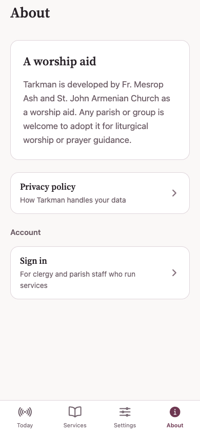
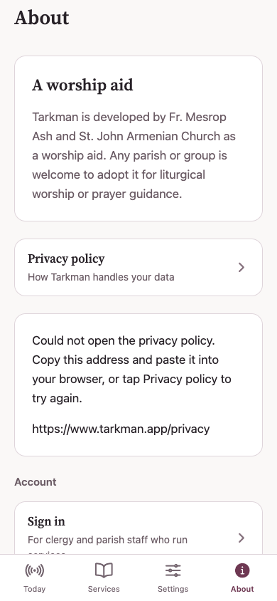

# Privacy-policy link recovery (#263)

## Implementation and scope

The About screen still asks the platform to open the existing public HTTPS policy URL. A rejected promise (or synchronous throw) now leaves a localized error and selectable address on screen. The same Privacy policy row retries; a successful retry clears the fallback. No authentication, new dependency, URL/domain change, browser replacement, or app-link configuration change is involved.

## Visual comparison

Both images are actual Expo web application captures: signed out, About tab, English, light theme, 390 × 844 CSS pixels, scale 1. Both exports use public placeholder API/cable hosts (`reader.invalid`), not production credentials or personal data.

The browser opener is deliberately fault-injected by replacing `window.open` with a function throwing `Error('Injected privacy browser refusal')` before page load. React Native Web converts that throw into the rejected `Linking.openURL` promise. This compares the shared About recovery UI; it is **not** a reproduction of the production iOS cause.

### Before — baseline `7776fad063852531f5bb214101b1ff9f8508a20a`

After tapping Privacy policy, no usable recovery is shown and the injected rejection is unhandled.

### After — implementation `feb65fc0` (same application tree in the evidence commit)

The same failed tap shows browser instructions and a selectable policy address, while preserving retry through the original row.

## External-navigation investigation

- On 2026-11-09 UTC, a normal TLS-validated GET of `https://www.tarkman.app/privacy` returned HTTP 200 directly, without a redirect or sign-in requirement, containing the real Privacy Policy. Current availability does not prove historical availability at the sampled event.
- The pinned [React Native v0.86.3 iOS implementation](https://github.com/facebook/react-native/blob/v0.86.3/packages/react-native/Libraries/LinkingIOS/RCTLinkingManager.mm) delegates to `UIApplication.openURL` with empty options. It rejects with “Unable to open URL” when the OS completion reports false; it does not fetch the page or return an underlying NSError explaining the refusal. The symptom therefore indicates a refused URL handoff, not necessarily an absent policy document.
- The app associates only `applinks:web.tarkman.app`; that site's AASA covers reader/Library routes, not this `www.tarkman.app/privacy` URL. The missing `www` AASA is not a prerequisite for opening ordinary HTTPS in a browser. No evidence supports adding `LSApplicationQueriesSchemes`, changing associated domains, or preflighting with `canOpenURL` as a fix.
- `xcrun simctl openurl 48A13996-F47B-44AD-AB5B-08FDEBF9C261 https://www.tarkman.app/privacy` succeeded on the available iOS 27.0 (24A434) simulator, and a simulator screenshot was visually inspected: Safari displayed the actual policy. This checks OS/browser navigation, not the app's native promise or the affected production build.

## Evidence limitation / remaining issue criterion

The exact iOS **27.0.1** refusal has **not** been reproduced or causally diagnosed. Installed runtimes include 27.0 and 26.5, not 27.0.1. The existing simulator app is old 0.2.0 (1), not production 0.2.6 (18), and is not a usable current Expo dev client. The linked Sentry issue's underlying event/device logs are not accessible through the available tools; the GitHub issue only contains the audit summary.

Completing that explicit issue criterion requires access to an affected 27.0.1 device/build or its Sentry event and device Console evidence. Useful discriminators are another ordinary HTTPS link, browser/default-browser availability, restrictions/MDM/Screen Time, foreground state, and the failing tap's native logs. These are investigation leads, **not diagnosed causes**. The draft PR must not claim that original refusal is fixed or reproduced merely because the rejection is now handled.
