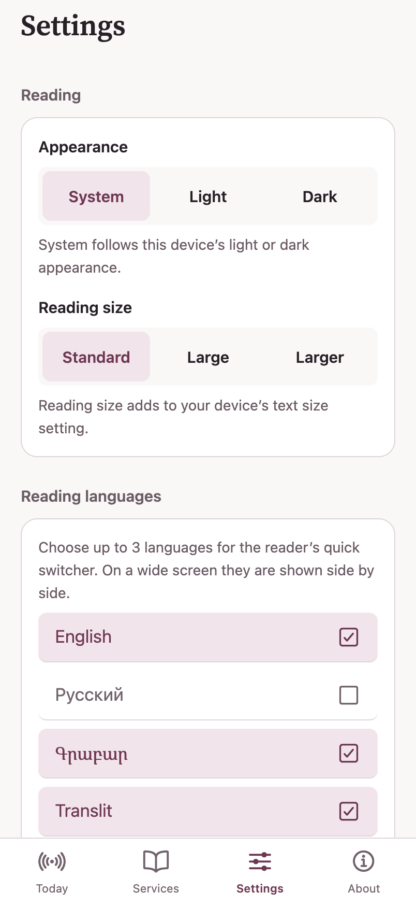

# SDK 58 compatibility evidence

Actual production web exports, fresh browser contexts, Chromium, 402 × 874 CSS
pixels at DPR 2, light appearance. Both use the same public `reader.invalid`
HTTPS/WSS endpoints and show the disconnected state; no personal app data.
The scenario opens Today, selects Services, then selects Settings, waiting for
URL and visible page content. Both finish without uncaught browser errors.

- **Before:** SDK 57 source `bde6b9875e4f91542363c4162ab9c915df101aec`.
- **After:** SDK 58 source `04d598dc2df8deb7348b88e8fb6dc03000fc021f`.

These screenshots demonstrate the JS-tab web scenario only, not native tab,
glass material, physical-device accessibility, or remote EAS build validation.
There is no intended design change. The later upstream Library rate-limit merge
and EAS image pin do not change this Settings scenario; captures identify the
actual source they show rather than claiming a later revision was captured.

| Before | After |
| --- | --- |
|  |  |
