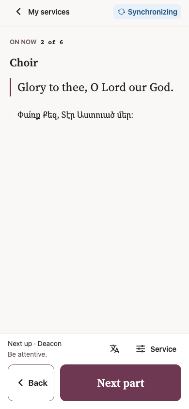
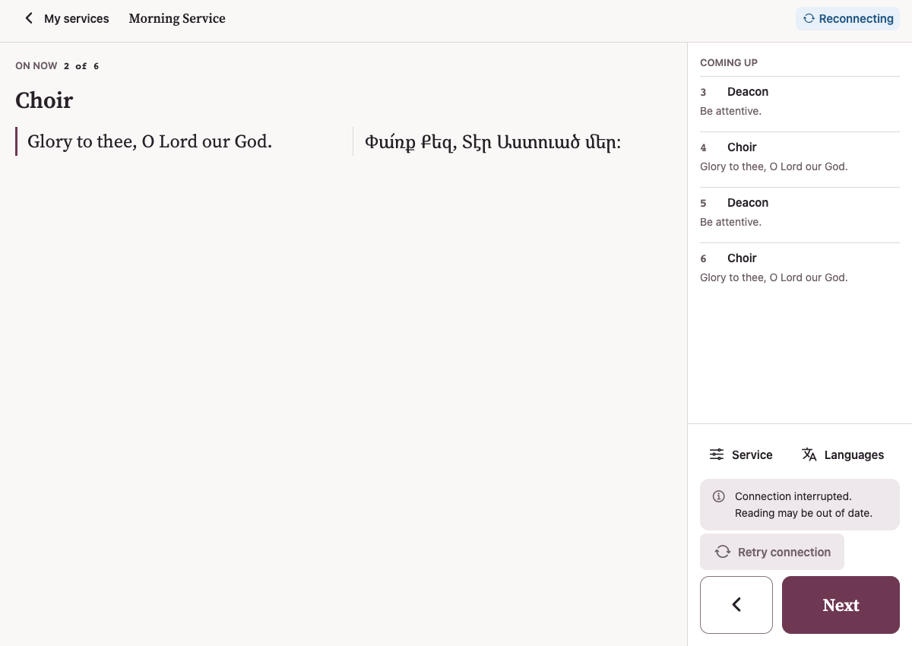

# Mobile control connection status

The control toolbar now reports the server connection instead of the service's display mode. Service mode remains available in the Service sheet, and the announcement band still provides Stop.

| Toolbar status | Meaning |
| --- | --- |
| Connecting | Initial connection has not been confirmed. |
| Connected | The live socket is connected and the reading is synchronized. |
| Synchronizing | A control command is awaiting acknowledgement, or the reader is fetching/verifying an update. |
| Reconnecting | The live socket is disconnected; automatic recovery is running. |
| Updates unavailable | A refresh failed even though the live socket is connected. |
| Offline | The device reports no network connection. |

The sync arrow rotates during connection/synchronization work and stays still when Reduce Motion is enabled. Routine status changes do not announce repeatedly to screen readers. The indicator consumes existing socket, lifecycle, command, and reader state; it adds no polling or network requests.

Previously, `ReaderStatus` treated any stale snapshot as a connection interruption. Normal ActionCable part-change events also mark the snapshot stale while canonical state loads, so a healthy connection could show Reconnecting plus a loading Retry connection button. Only an actual disconnected socket now produces that warning. HTTP refresh failures have their own label.

The controller no longer shows the discovery feed's Not live notice: absence from today's listing does not describe the connection or prevent controlling a historical service. Initial loading stays in the empty reading pane. Actionable connection and refresh errors appear beside the control deck, with a retry action, rather than above the current reading.

The toolbar reserves the width of its longest translated status label. Its badge can change width inside that space without reflowing the toolbar. At narrow widths where the toolbar needs two rows, both rows remain present across connection states. The reading and navigation controls keep their positions.

## Validation

- Mobile Jest: 37 suites / 411 tests passed. Regression coverage includes ordinary synchronization, control acknowledgement, actual disconnection, successful HTTP recovery while the socket remains disconnected, failed refresh, offline controls, and announcement controls.
- Mobile TypeScript, ESLint (excluding generated coverage output), UI and i18n guards passed. The focused design detector returned no findings.
- Production Expo web export and web production build passed. Sentry upload was disabled for the local web build.
- A Chrome fixture mocked all HTTP and WebSocket traffic. No production service commands were sent. Checks covered connected, synchronizing, reconnecting, HTTP failure, retry recovery, and offline states at 320x768, 390x844, 820x1180, and 1200x850.
- Across every tested state, the current-position row, role heading, and Next button retained identical vertical coordinates. No horizontal overflow or browser errors occurred. Rotation and the browser's reduced-motion preference were checked.
- Existing gesture-worklet and delayed Jest-exit warnings remain. Native iOS/Android layout, animation, dynamic type, and assistive-technology behavior still need device verification. The Russian catalog remains a draft under the existing language policy.

The screenshots below use synthetic local fixture data.

