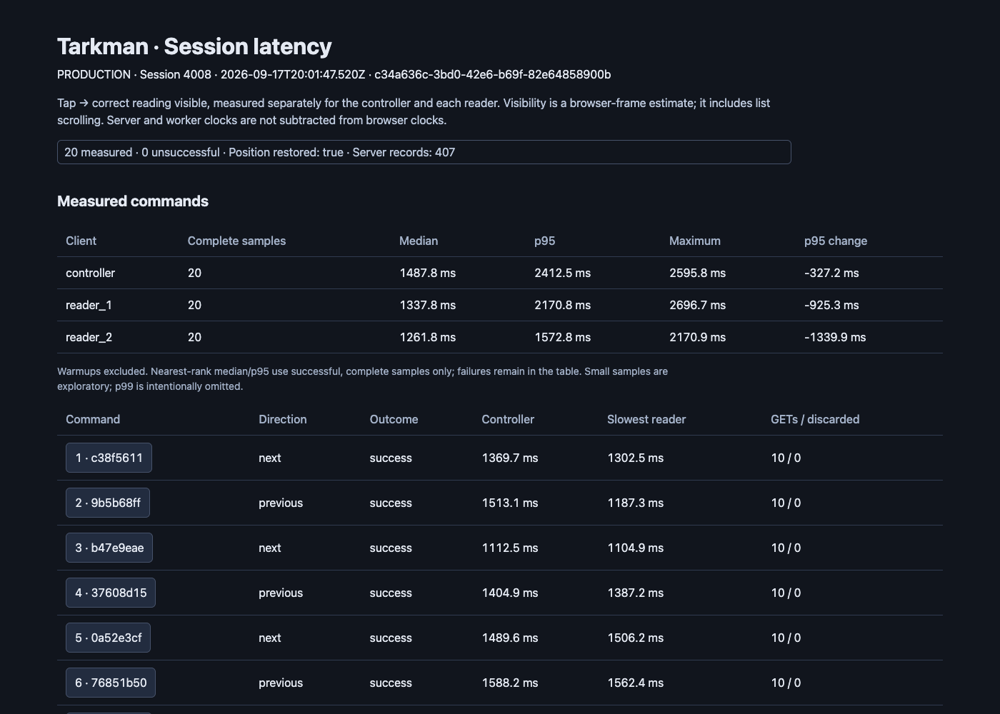

# Mobile session-control latency improvement

Implemented in the isolated client worktree `/private/tmp/tarkman-client-latency`, on `codex/session-latency-benchmark`. The user's primary checkout is preserved. This branch contains the benchmark runner and mobile optimization; it has not been deployed as a client release. The production backend was unchanged during the comparison.

## Measured result

Same Expo mobile web runner, production Render web/worker/database, session 4008, Chrome 152, 430 × 932 viewport, one signed-in controller and two independent readers. Each completed comparison uses four warmups and twenty measured alternating Next/Previous commands, with the same minimum two-second start interval and readiness checks. All backend records in these runs identify `c5171948a746d8c516acae90877c39148cbeb127`.

| Client | Before median | Final median | Median reduction | Before p95 | Final p95 |
| --- | ---: | ---: | ---: | ---: | ---: |
| Controller | 2,223 ms | 1,488 ms | 33.1% | 2,740 ms | 2,413 ms |
| Reader 1 | 2,681 ms | 1,338 ms | 50.1% | 3,096 ms | 2,171 ms |
| Reader 2 | 2,297 ms | 1,262 ms | 45.1% | 2,913 ms | 1,573 ms |

Across the measured command windows, recovery GETs fell from **425 to 214** (49.6% fewer); full parts responses fell from **85 to 3** (96.5% fewer). Controller recoveries fell from 41 to 21, with discarded results falling from 21 to one. Counts include ordinary polling within armed command windows. A shorter completed run can contain fewer polls, so do not interpret every request-count difference as a per-command guarantee.

A scrolling-only intermediate run reduced reader medians to 1,532 / 1,480 ms, with controller median essentially unchanged at 2,273 ms. The readers' accepted-data-to-visible interval fell from approximately 800 ms to 28 / 31 ms. In the final build that interval was approximately 24 / 23 ms. This isolates a substantial scrolling contribution, while overall timing also varies with server/network scheduling.

The final run `c34a636c-3bd0-42e6-b69f-82e64858900b` covered 20:01:47–20:02:46 UTC on 2026-09-17. All 24 commands including warmups succeeded and session 4008 returned to `lp:219`. Its 407 correlated server/cable/job records had no missing requests/jobs, malformed records, truncated pagination or dropped spans. The baseline run was `8b0d2ff0-bcd5-4457-9653-11d475e9771e`, 19:46:13–19:47:31 UTC.

These are pilot results, not a native-device measurement, SLO, or guarantee. Timing uses the beginning of the correct reading stable in the viewport for two animation-frame intervals. Warmups are excluded from percentiles. The unchanged minimum cadence allows faster runs to finish earlier; server/cache conditions are not perfectly controlled. Do not add separately measured stage medians as if they were one command.

## What changed

- `PartList.tsx` puts the newly accepted live reading into position immediately. Manual browsing, language changes, Return to live, occurrence keys and long-distance jump support remain. This removes the transition animation; it does not alter swipe navigation.
- `controller.ts` distinguishes navigation recovery from full recovery. For a recently loaded manifest with matching content context, navigation reads session state and explanations, then verifies session state again. It reuses the existing parts and discovery data. That preserves stable row objects and avoids repeatedly downloading the full reading text.
- Full refreshes remain on initial load, reconnect, foreground/network restoration, manual retry, status/explanation events and the existing 30-second poll. An expired cache, missing current occurrence or changed content context forces another parts fetch.
- An acknowledgement/event received before final verification can be covered by that verification. Explanations are also refreshed after a covered notification, because an earlier explanation response could belong to an older part. A notification arriving during that refresh/verification, or a full invalidation, still requires a rerun. Changed before/after session state is never accepted.
- `ServiceControlProvider` uses the navigation refresh after command completion; explicit Retry still forces recovery. Commands retain their existing authorization, expected-part guard and no-automatic-retry behavior.
- `contracts.ts` compares ordered liturgies, part count, readings, options and relevant status fields to decide whether the loaded text context still matches. This is not a server content version. Signed avatar URLs and other unrelated response fields are excluded.
- Generated `dist-*` exports are ignored by Git and lint so the benchmark's compiled JavaScript does not contaminate source checks.

## Freshness and remaining limits

A direct edit to a Part's text that produces no relevant session event and does not change the session content fields is discovered on the next successful full poll or explicit refresh. Navigation does not extend the manifest's age. Discovery membership likewise updates on full refresh. This bounded reuse is a deliberate tradeoff; instant propagation of arbitrary content edits needs a backend content revision or invalidation event.

Canonical session reads are still on the critical path. Removing the second read or applying event IDs directly would need an atomic/versioned protocol. The existing backend does not represent independent repeated occurrences completely: it deduplicates reusable parts when navigating and publishes no occurrence revision. Tests verify that the client preserves its current resolver for single/multiple liturgies and supplied occurrence positions; they do not establish new backend repeated-occurrence semantics.

Native iOS/Android performance and the feel of immediate scrolling still need device validation. Expo web results do not prove those outcomes.

## Rejected experiment and restoration

An initial combined implementation compared too much raw session metadata. A signed `church_avatar` URL changed between otherwise identical reads, repeatedly invalidating snapshots. That run (`mobile-optimized`) became slower and stopped on its 23rd command after a visibility timeout. It is retained as a rejected experiment, not included in the successful comparison.

After confirming the accepted command had left the session at part 217 / `lp:220`, one guarded Previous command restored part 216 / `lp:219`; `restoration.json` records the verified before/after state. The final comparison then started and ended at the original position. A regression test now varies avatar signatures between reads and verifies that navigation completes without refetching the manifest. No records or analytics were deleted.

This work issued 96 production transitions in total: 24 baseline, 24 scrolling-only, 23 in the rejected pilot, one verified restoration, and 24 final. These remain normal test-session analytics activity.

## Validation and artifacts

- Mobile: 37 suites / **405 tests passed**, including 20 new navigation-recovery cases; TypeScript, lint and production Expo web export passed. The PR-preparation coverage run also passed all 405 tests (controller: 100% line coverage, 94.91% branch coverage).
- PR checks: five benchmark-tool tests and 356 web tests passed; the web production build including TypeScript passed.
- Cases include overlapping notifications, late verification, explanations, signed-avatar churn, single/multiple liturgies, repeated occurrence resolution, content/context changes, missing occurrences, polling, reconnect, offline/failure, disposal and manual browsing.
- Existing gesture-worklet and delayed Jest-exit warnings remain in the test output; the test process completed with exit code zero.
- The web display was reviewed separately in [web-session-display-review.md](web-session-display-review.md); no web runtime performance claim is made.

Durable artifacts are in `/Users/mattash/Projects/Tarkman/output/latency-benchmark/2026-09-17/mobile-optimization/`: before, scrolling-only, rejected and final reports/raw captures; the final before/after comparison; restoration evidence; the source patch; and validation logs. `final/report.html` is the interactive comparison. `final/comparison.json` preserves all four runs, including failure metadata.

Reproduction uses the existing commands in `tools/latency-benchmark/README.md`. The final export remains served at `http://localhost:8101`, pointed at production. The benchmark profile remains local and excluded from all artifacts.
