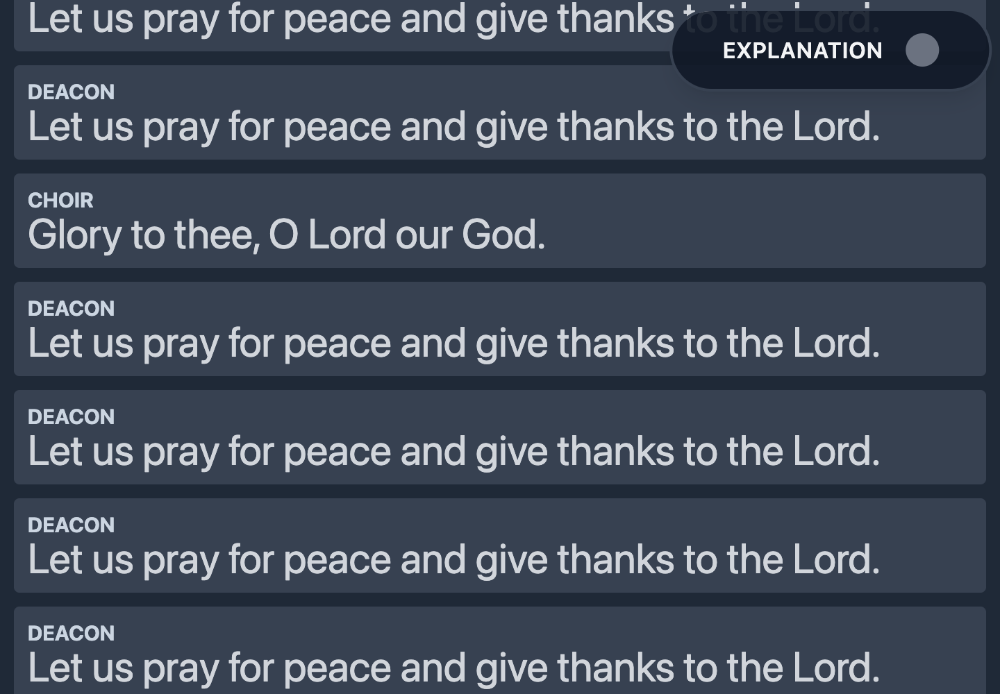
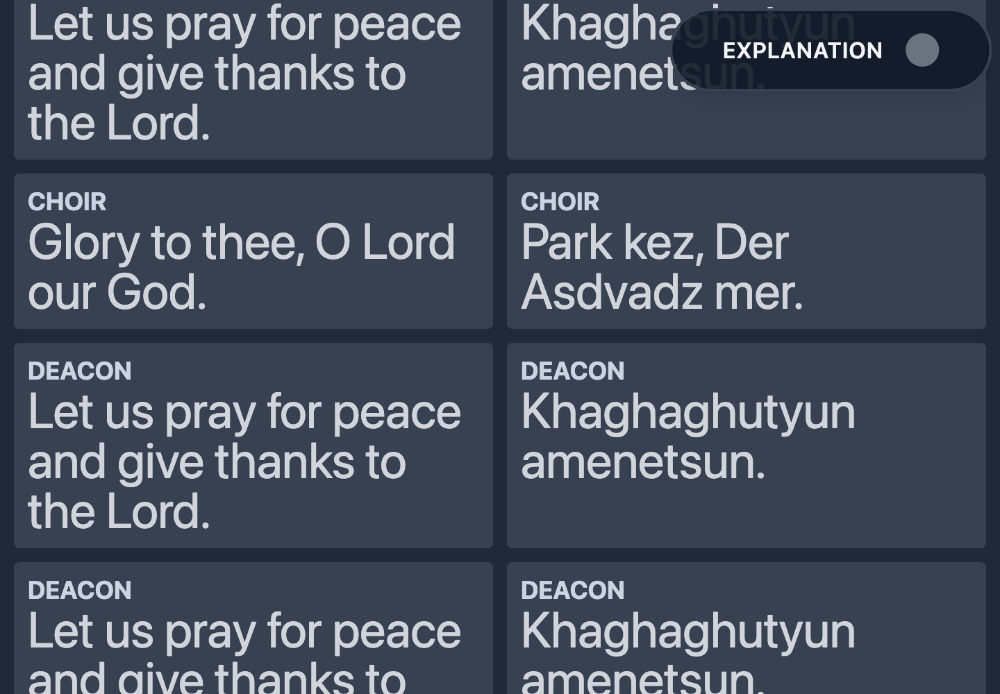

# Repeated-reading navigation

Companion client changes for [Tarkman #435](https://github.com/mattash/Tarkman/issues/435).

A Part is reusable text; a `liturgy_part_id` identifies its place in the service. The backend is changing navigation to visit every occurrence, including adjacent uses of the same Part and repeats across liturgies.

## Client behavior

- Mobile already reconciles revisioned state against occurrence keys. Canonical session recovery now also retains `revision` and `current_liturgy_part_id`, and selecting a reading in the controller sends both the Part ID and destination `liturgy_part_id`.
- Web single and parallel displays key their rows, DOM references, highlight, and scrolling by occurrence. A same-Part event with a different cursor moves to that occurrence. Delayed canonical responses, older events, and duplicate events cannot rewind the accepted revision or repeat the scroll.
- Web controller boundaries use the exact occurrence, and navigation sends the expected revision so a stale same-Part command is rejected.
- Older server responses remain supported through Part ID plus position/liturgy fallback. An explicitly supplied but unknown occurrence never substitutes another use of the same Part.

This is the occurrence compatibility work. [Client #156](https://github.com/mattash/Tarkman-Client/issues/156) still tracks the full web state-endpoint, reconnect, revision-gap and content-refresh work; the existing web polling cadence remains.

## Validation (2026-09-17)

- Mobile: full Jest suite with coverage (471 passing), then focused contract/control tests after adding canonical repeated-slot coverage.
- Web: full Vitest suite with coverage (358 passing), then focused hook/controller tests after adding unknown-slot coverage.
- Both TypeScript checks and production web builds passed; mobile lint, UI and i18n checks passed.
- Production-built web client verified in Chrome at 1440 × 1000 with mocked HTTP and ActionCable, in single and parallel modes. Eight occurrence slots included Part 31 at `lp:1001` and `lp:1004`. The initial revision was 10, followed by revision 11 selecting `lp:1004`.
- Each layout retained exactly one selected row, scrolled to the second occurrence, and ignored revision-10 polling responses, a duplicate revision-11 event, and an older revision-10 event. No page errors; one manifest fetch per layout.

These browser checks use a synthetic fixture, not a new production latency benchmark. Native touch behavior was covered by existing component tests, not a new device run.

### Single-language display after the repeated-slot event

### Parallel display after the repeated-slot event

## Release order

Release these compatible clients first, then deploy the backend migration and occurrence-aware worker/web code. Existing client bundles should be refreshed before controlling a service with repeated readings. Legacy Part-only selection remains deterministic but selects the first occurrence and cannot express a later repeated slot.
